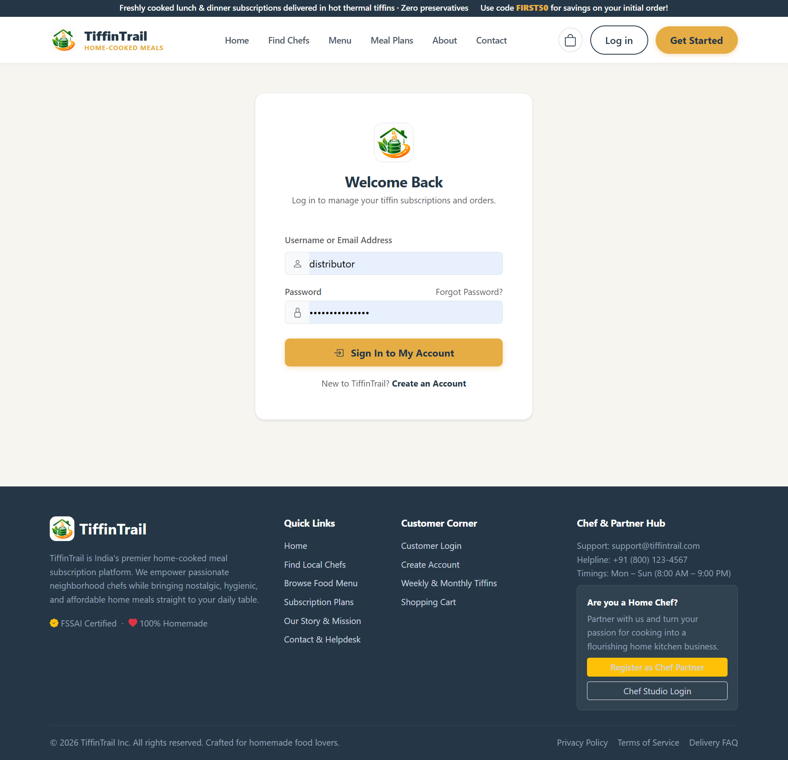
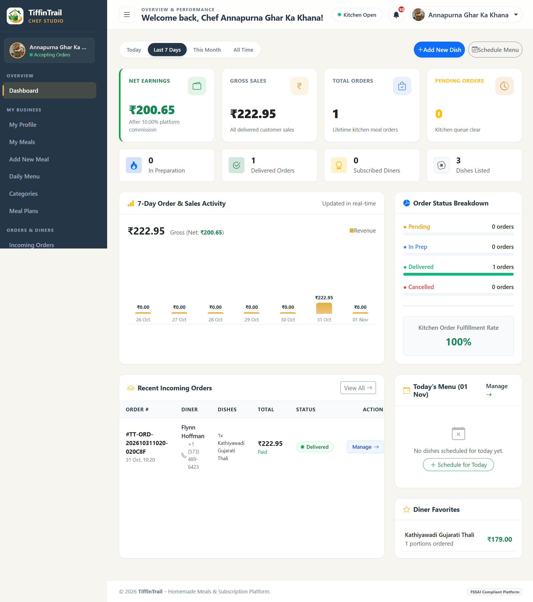
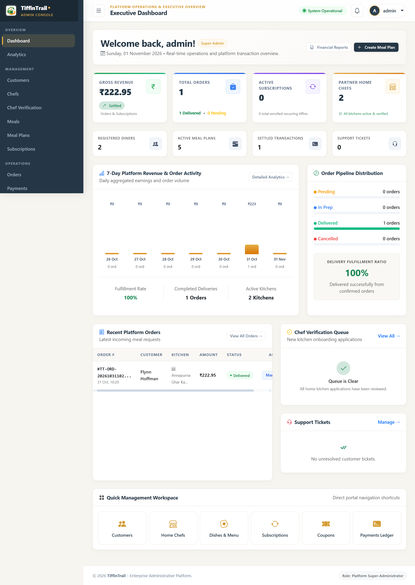

# TiffinTrail

TiffinTrail is a Django-based homemade meal ordering and tiffin subscription platform that connects home food lovers with verified neighborhood home chefs, featuring on-demand ordering, meal subscriptions, Razorpay & COD payments, coupon management, and dedicated portals for Customers, Home Chefs, and Platform Administrators.

## Project Features

- User roles for Customer, Home Chef, and Platform Administrator with role-based access
- Homemade meal listings with categories, dietary badges (Veg/Non-Veg), spice levels, and allergens
- Recurring meal subscription packages (Daily, Weekly, Monthly) with pause, resume, and cancellation
- Real-time shopping cart with automated 5% GST tax calculation and flat/percentage discount coupons
- Payment processing with Razorpay online gateway and Cash on Delivery (COD) options
- Live 5-stage order tracking (Received, Confirmed, Cooking, Out for Delivery, Delivered)
- Customer reviews and 5-star rating system for verified meals and kitchens
- Dedicated Home Chef portal for order fulfillment, menu scheduling, and earnings management
- Superuser Admin dashboard for chef verification, user management, complaint tickets, and financial analytics
- Secure authentication flows including registration, email OTP verification, and login

## Setup Commands

### Clone Repository

```bash
git clone https://github.com/brainybeamGit/TiffinTrail-Django-P1.git
cd TiffinTrail-Django-P1/TiffinTrail
```

### Installation on macOS/Linux

```bash
# Create and activate virtual environment
python3 -m venv .venv
source .venv/bin/activate

# Install dependencies
pip install -r requirements.txt

# Create environment file
cp .env.sample .env

# Run migrations
python manage.py migrate

# Load sample data
python manage.py shell < scripts/seeds.py

# Start development server
python manage.py runserver
```

### Installation on Windows

```powershell
# Create and activate virtual environment
python -m venv .venv
.venv\Scripts\activate

# Install dependencies
pip install -r requirements.txt

# Create environment file
Copy-Item .env.sample .env

# Run migrations
python manage.py migrate

# Load sample data
python manage.py shell < scripts/seeds.py

# Start development server
python manage.py runserver
```

## LocalServer
http://127.0.0.1:8000/

## credentials

User:- admin<br>
Email:- admin123@gmail.com<br>
Password:- admin123

## Test User Credentials

| Role      | Username   | Password      |
|-----------|------------|---------------|
| Home Chef | `amrita`   | `chef123`     |
| Home Chef | `dklakum`  | `chef123`     |
| Customer  | `dk`       | `customer123` |

## Screenshots

### 1. Home Page


### 2. Login Page


### 3. Chef Dashboard


### 4. Admin Panel

